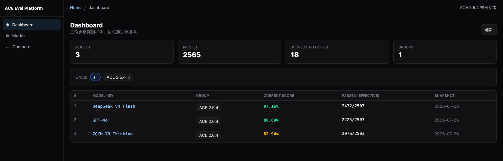
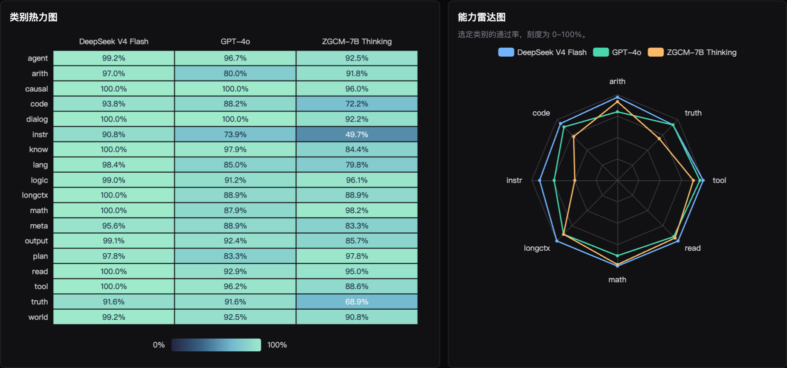
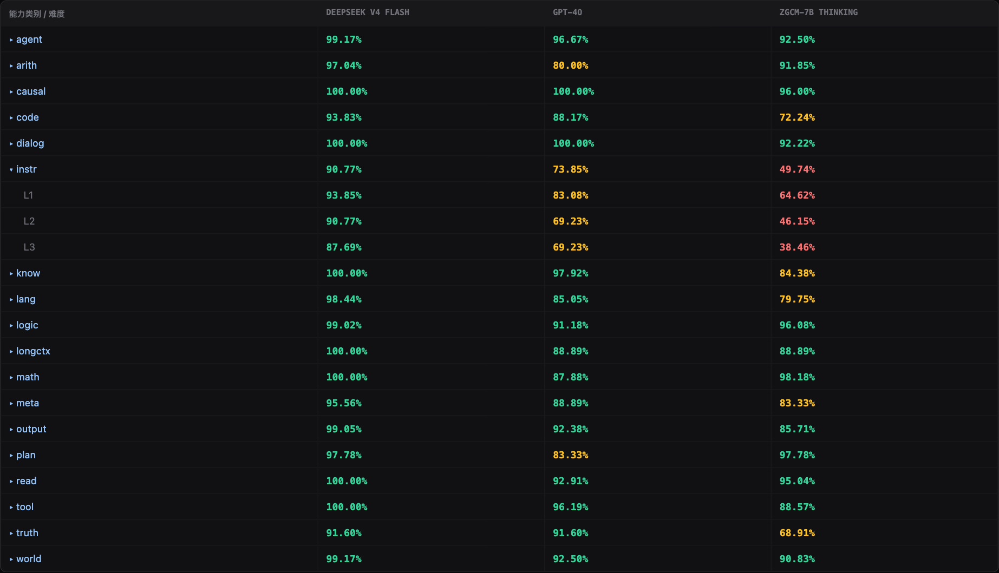
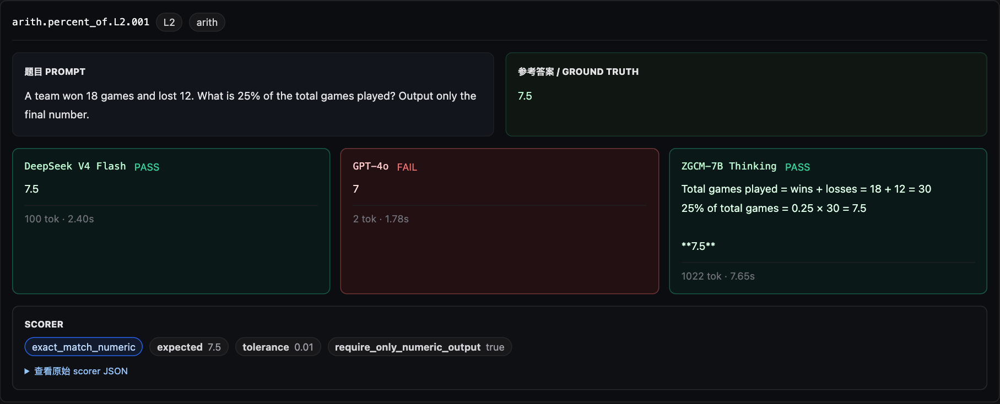

# Compare models in the ACE frontend

[简体中文](tutorial.zh-CN.md)

Start a local HTTP server from the repository root and open `http://127.0.0.1:8000/frontend/`. The frontend loads the three bundled result summaries by default. Your browser needs access to the pinned Vue and ECharts assets. Sample mode runs without an evaluation backend or API key.

```bash
python3 -m http.server 8000 --bind 127.0.0.1
```

## 1. Review scores and filter models

`Dashboard` ranks the sample models by overall pass rate and shows how many scored probes each model passed. Use `Models` to filter by model name or group. Select a model to see its scores by capability category and difficulty.

| Model | Passed / scored | Overall pass rate |
| --- | ---: | ---: |
| [DeepSeek V4 Flash](results/deepseek-v4-flash.json) | 2,432 / 2,503 | 97.16% |
| [GPT-4o](results/gpt-4o.json) | 2,225 / 2,503 | 88.89% |
| [ZGCM-7B Thinking](results/zgcm-7b-thinking.json) | 2,076 / 2,503 | 82.94% |

These results come from the July 26, 2026 ACE 2.6.4 snapshot after score review. Each run covered 2,565 probes, with 62 excluded and 2,503 scored. The sample files include aggregate counts and pass rates for 18 scored categories and their difficulty levels. New runs with the public release score 2,489 probes. Check the denominator when comparing them with the historical samples.



## 2. Compare capability profiles

Open `Compare` to see all three sample models. Click model labels to change the selection, then click **分析** (Analyze) to update the comparison.

- The **category heatmap** places models in columns and capability categories in rows. Both the color and cell value represent the pass rate. Hover over a cell to see the value to two decimal places.
- The **capability radar chart** overlays the selected models on a common 0–100% scale across eight categories. The axes cover arithmetic, code, instruction following, long context, math, reading, tool use, and truthfulness.



## 3. Find score differences by difficulty

Below the charts, expand `instr` to see pass rates for L1–L3. In the sample, ZGCM-7B Thinking scores 98.18% in `math` and 49.74% in `instr`. Expand either category to see which difficulty levels account for the gap.



## 4. Read model answers to the same probe

With a compatible backend connected, select the models in `Compare` and click **分析** (Analyze). Expand a category, an atomic capability, and a difficulty level to see the prompt, reference answer, and each model’s response and verdict.

The screenshot shows the recorded answers to `arith.percent_of.L2.001` from the same historical runs. DeepSeek V4 Flash answers `7.5`, GPT-4o answers `7`, and ZGCM-7B Thinking shows its calculation and ends with `7.5`. The archived scorer extracted the number from the last line of ZGCM-7B Thinking’s response and marked it as a pass.



## Connect the evaluation platform API

Deploy the API on the same origin, at `/api` alongside `/frontend/`. Add `?mode=api` to the frontend URL and enter the platform access token in the sidebar. Open the relevant page or refresh its data. Per-probe comparison, diagnostics, run management, and Playground use the compatible backend API.
