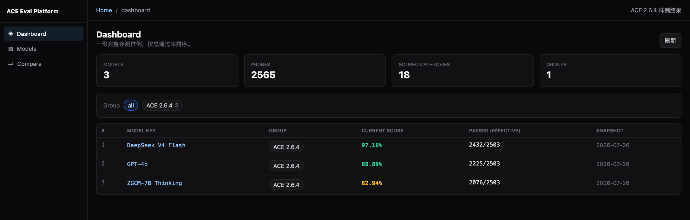
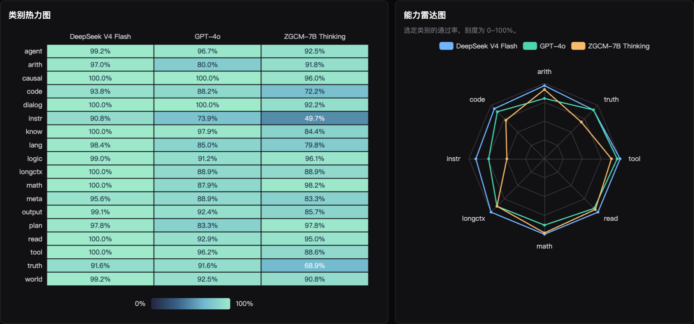
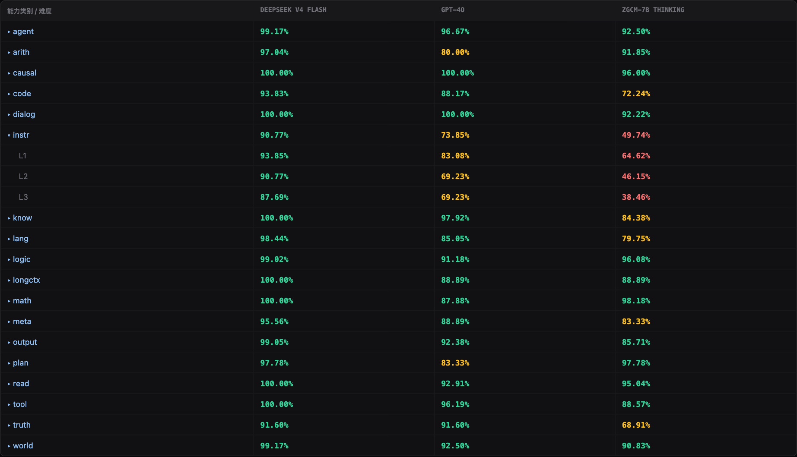

# 用 ACE 前端对比模型

在仓库根目录启动本地 HTTP 服务，再打开 `http://127.0.0.1:8000/frontend/`。页面默认读取随仓库提供的三份汇总结果。浏览器需要能加载页面指定版本的 Vue 和 ECharts，查看样例无需评测后端或 API 密钥。

```bash
python3 -m http.server 8000 --bind 127.0.0.1
```

## 1. 看总分并筛选模型

`Dashboard` 按总通过率排列样例，同时显示通过题数和有效题数。到 `Models` 可按模型名称或组筛选，点击模型可查看该模型的类别和难度成绩。

| 模型 | 通过 / 有效题 | 总通过率 |
| --- | ---: | ---: |
| [DeepSeek V4 Flash](results/deepseek-v4-flash.json) | 2,432 / 2,503 | 97.16% |
| [GPT-4o](results/gpt-4o.json) | 2,225 / 2,503 | 88.89% |
| [ZGCM-7B Thinking](results/zgcm-7b-thinking.json) | 2,076 / 2,503 | 82.94% |

样例来自 2026 年 7 月 26 日的 ACE 2.6.4 存档快照，采用复核调整后的成绩。每个模型覆盖 2,565 道题，排除 62 道后按 2,503 道题计分。样例文件包含汇总计数、18 个计分类别的通过率及各难度通过率。公开版新评测按 2,489 道题计分，使用历史样例时请留意分母。



## 2. 对比能力分布

进入 `Compare`。页面默认对比三份样例。点击模型标签可增减模型，点击 **分析** 更新对比。

- **类别热力图**将模型排在列上、能力类别排在行上。色阶和单元格数值均表示通过率，悬停可查看两位小数。
- **能力雷达图**在相同的 0–100% 刻度上叠加各模型。它选取算术、代码、指令遵循、长上下文、数学、阅读、工具和真实性八类，便于观察同一模型的强弱分布。



## 3. 展开类别定位分差

在图下方点击 `instr` 展开 L1–L3。样例中，ZGCM-7B Thinking 在 `math` 上通过率为 98.18%，在 `instr` 上为 49.74%。展开后可以检查差异集中在哪个难度。若连接兼容的评测平台后端，对比表可继续展开到原子能力和逐题判定。



### 连接评测平台 API

在同源部署中，将 API 挂载到前端目录的同级 `/api` 路径。例如前端位于 `/frontend/` 时，API 位于 `/api`。在前端页面 URL 中加上 `?mode=api`，在侧栏输入平台访问令牌，然后打开所需页面或刷新页面内的数据。逐题对比、诊断、运行管理和 Playground 使用兼容后端的接口。
